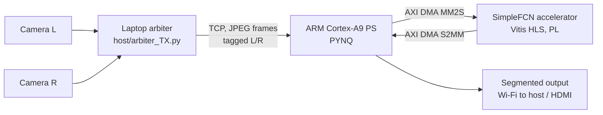

# Road-Scene Segmentation on the PYNQ-Z2

A driver-assistance prototype that runs semantic segmentation on a custom FPGA accelerator. A tiny INT8 network, SimpleFCN, was designed to fit the on-chip memory of the Zynq XC7Z020, synthesized with Vitis HLS, and wired into the PYNQ base overlay through AXI DMA. Two cameras feed the board through a laptop that interleaves their frames over the network.

Course project for EE712 (Embedded Systems Design) at IIT Bombay, Jan to Apr 2026, under Prof. Laxmeesha Somappa.

## Team

| Member | Contributions |
| --- | --- |
| Amol Pagare | Dual-camera interfacing; Vitis HLS synthesis of the segmentation model; custom PL IP integration; resource utilisation analysis |
| Arnav Agarwal | SimpleFCN architecture design and training; INT8 post-training quantisation; resource utilisation analysis; HLS synthesis support |
| Neil George | Explored DPU-based deployment with Brevitas and FINN; documented the toolchain issues that led to the switch to HLS |
| Mitul Tandon | Segmentation model comparison and selection; optimisation of the model for BRAM-constrained deployment |
| Tanish Raghute | Dual-camera interfacing; base-overlay modifications for the HDMI video output pipeline |

## System



**Why a laptop arbiter.** A passive USB hub could not power two webcams on the board, and a powered hub was out of budget. Both cameras plug into a laptop instead; `arbiter_TX.py` reads one frame from each, JPEG-encodes them, and sends them back to back over TCP with a 5-byte header (length and camera ID). The receiver on the board is `pynq/pynq_RX.ipynb`.

## Model: SimpleFCN

The original plan was ENet (352k parameters) on the Xilinx DPU. ENet's weights alone exceed what the XC7Z020's 630 KB of block RAM can hold once activations and buffers are counted, so the team designed a much smaller network from scratch.

| Property | Value |
| --- | --- |
| Layers | Conv 3→8 (s2), Conv 8→16 (s2), Conv 16→32, ConvT 32→16 (×2), Conv 16→16, ConvT 16→8 (×2), 1×1 head 8→4 |
| Parameters | 11,116 |
| Weights | 10.9 KB at INT8 (43.4 KB at FP32) |
| Input / output | 128×128 RGB → 128×128 class map |
| Classes | Road, Obstacle, Structure, Background |

`model/export_fcn_hls.py` folds BatchNorm into the convolution weights, quantises each tensor to INT8 with a power-of-two scale, and writes the C header the HLS kernel reads.

**Training** (`model/train_fcn.py`, log in `model/train_fcn.log`):

1. 100 epochs on Cityscapes (2,975 train / 500 val), classes remapped to the four above. Best mIoU 0.385.
2. Fine-tuned for 50 epochs on Cityscapes + IDD combined (10,009 images), validated on IDD (1,055 images of Indian roads). **Best mIoU 0.557** at epoch 46:

| Class | IoU |
| --- | --- |
| Road | 0.816 |
| Background | 0.775 |
| Obstacle | 0.345 |
| Structure | 0.292 |

## Accelerator

The kernel takes a 128×128 frame over AXI-Stream, runs the network layer by layer with pipelined MAC loops, and streams the class map back. The weights are compiled into on-chip ROMs.

HLS estimates (`hls/reports/csynth.rpt`, Vitis HLS 2020.2, 100 MHz target): 231 BRAM_18K, 29 DSP, 4,690 FF, 12,238 LUT, and a latency of 21.3 M cycles, about 213 ms per frame at 100 MHz. These are pre-implementation estimates; the HLS report shows a small negative timing slack.

Post-implementation utilisation of the full system (base overlay, accelerator, HDMI modules and interconnect) on the XC7Z020:

| Resource | Used | Available | Utilisation |
| --- | --- | --- | --- |
| LUT | 9,006 | 53,200 | 16.9% |
| LUTRAM | 162 | 17,400 | 0.9% |
| FF | 11,145 | 106,400 | 10.5% |
| BRAM (36K) | 121.5 | 140 | 86.8% |
| DSP | 29 | 220 | 13.2% |

## Repository layout

| Path | Contents |
| --- | --- |
| `model/` | SimpleFCN definition, training script, Cityscapes and IDD loaders, HLS weight exporter, cleaned training log |
| `hls/reports/` | Vitis HLS synthesis reports, top level and per layer |
| `hls/rtl/` | Verilog generated by Vitis HLS, including the weight ROM `.dat` files |
| `hls/script.tcl`, `hls/directives.tcl` | The HLS project script and directives as run |
| `overlays/accel/` | `seg.bit` / `seg.hwh`: overlay with the segmentation accelerator and AXI DMA |
| `overlays/hdmi/` | `base_wrapper.bit` / `base.hwh`: modified base overlay with the HDMI output path |
| `host/arbiter_TX.py` | Laptop-side dual-camera frame arbiter |
| `pynq/pynq_RX.ipynb` | Board-side receiver with HDMI output |
| `docs/` | Project proposal, final report, presentation |

The HLS C++ source for the final synthesis run is not in this repository yet; `hls/rtl/` holds the RTL it produced.

## Running it

On the laptop, with both cameras attached:

```sh
pip install opencv-python numpy
python host/arbiter_TX.py --pynq-ip <board-ip> --port 9999
```

On the PYNQ-Z2, open `pynq/pynq_RX.ipynb` in Jupyter and run the cells in order; start the receiver before the arbiter. Load `overlays/accel/seg.bit` with `pynq.Overlay` to use the accelerator.

## Limitations

- Stereo depth estimation and the rule-based braking and speed logic from the proposal were not completed; the pipeline ends at the segmented frame.
- HDMI output needed base-overlay changes that ran into Vivado IP version conflicts, so the main demo streamed the segmented output over Wi-Fi to the laptop.
- No end-to-end frame rate was measured; the latency above is the HLS estimate for the accelerator alone.
